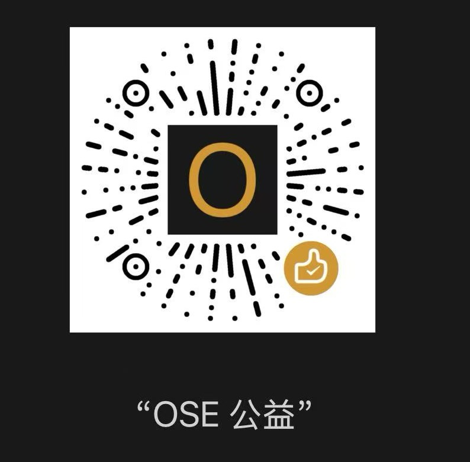

# 社科课题选题、申报与审核全能助手
# Social Science Grant Assistant: Topic Development, Application & Review

面向高校、党政机关、科研院所及其他事业单位的中英双语 Codex Skill，适用于国家社科基金、省级社科规划和相关单位课题。

A bilingual Codex skill for universities, government and Party bodies, research institutes and other public institutions applying to Chinese national, provincial or institutional social science programs.

- **申报合规 / Compliance** — 核对官方模板、字数、栏位、匿名和附件。 Check official templates, length limits, fields, anonymity and attachments.
- **写作与论证 / Drafting and rationale** — 审查选题、研究问题、方法和论证。 Review the topic, research questions, methods and rationale.
- **文献与审改 / Literature and editing** — 核实引文、梳理综述、标出前后矛盾、修改机器腔。 Verify citations, structure the review, flag contradictions and revise formulaic prose.

## 使用 / Usage

将本仓库内容放入 Codex 技能目录下的 `social-science-grant-review` 文件夹，保留相对路径。附上当次公告、模板和可供审核的初稿，再调用 Skill。

Copy this repository into a folder named `social-science-grant-review` in the Codex skills directory, preserving relative paths. Attach the relevant call, template and draft, then invoke the skill.

> 用 $social-science-grant-review 审核这份申请书和论证活页，列出格式问题、事实矛盾和可直接使用的修改稿。
>
> Use $social-science-grant-review to review this application and prospectus. List formatting issues and factual inconsistencies, and provide replacement text where possible.

## 赞助支持 / Support the Project

可用微信扫描「OSE 公益」赞赏码，自愿支持项目维护和资料更新。

Scan the OSE support code with WeChat to voluntarily support maintenance and updates.

